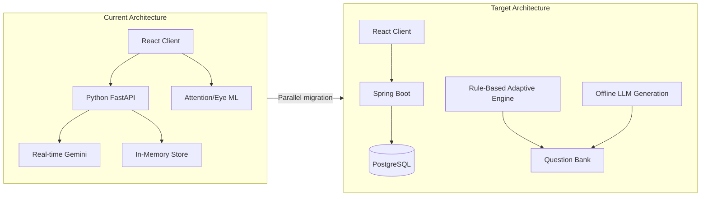
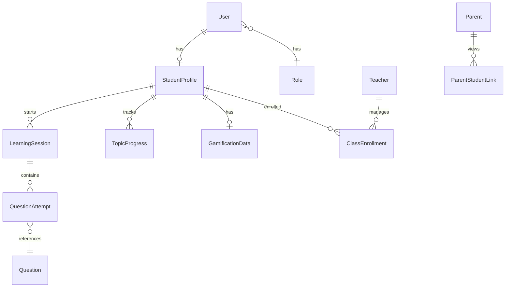
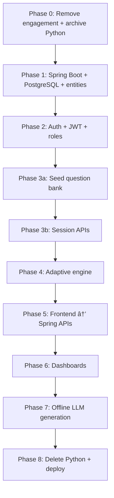

---
name: NeuroLearn Migration Plan
overview: Migrate NeuroLearn from a Python/FastAPI neuro-adaptive prototype (real-time Gemini, attention tracking, no persistence) to a Java/Spring Boot + PostgreSQL enterprise adaptive learning platform (performance-based rules, question bank, auth, role dashboards), using a parallel-build strategy while gradually retiring the Python backend. Scope is the 100-hour coursework MVP only — research extension is explicitly deferred.
todos:
  - id: phase-0-cleanup
    content: "Phase 0: Move Python to legacy-python/, remove engagement/attention from frontend, drop language scope, replace README"
    status: pending
  - id: phase-1-spring
    content: "Phase 1: Bootstrap Spring Boot in backend-java/, Docker Compose PostgreSQL, JPA entities + Flyway migrations"
    status: pending
  - id: phase-2-auth
    content: "Phase 2: Spring Security JWT, register/login, Student/Teacher/Parent roles, React auth pages"
    status: pending
  - id: phase-3-learning
    content: "Phase 3: Question bank CRUD, seed ~50-100 math questions, session start/submit/complete APIs"
    status: pending
  - id: phase-4-adaptive
    content: "Phase 4: Rule-based AdaptiveEngine module with explainable decisions, DB question selection"
    status: pending
  - id: phase-5-frontend
    content: "Phase 5: React Router, migrate pages to Spring APIs, remove localStorage/Gemini client, simplify Learn mode"
    status: pending
  - id: phase-6-dashboards
    content: "Phase 6: Student/Teacher/Parent dashboards with performance-only metrics"
    status: pending
  - id: phase-7-ai-offline
    content: "Phase 7: Admin offline LLM question batch generation + bulk import"
    status: pending
  - id: phase-8-deploy
    content: "Phase 8: JUnit + Testcontainers tests, Docker deployment, delete legacy-python/"
    status: pending
isProject: false
---

# NeuroLearn Migration Plan: Old Prototype → New Architecture

> **Scope:** Coursework MVP only (~100 hrs). Parallel Spring Boot build, math-only, no engagement model, no research/IRB/benchmark work. IEEE/EDM extension is deferred indefinitely.

## Current vs Target (Gap Analysis)


| Dimension  | Current ([README.md](README.md))                                      | Target ([NeuroLearn.md](c:\Users\dheem\OneDrive\Desktop\NeuroLearn.md)) |
| ---------- | --------------------------------------------------------------------- | ----------------------------------------------------------------------- |
| Backend    | Python FastAPI ([backend/app.py](backend/app.py))                     | Java Spring Boot REST API                                               |
| Database   | In-memory dicts + frontend `localStorage`                             | PostgreSQL with JPA entities                                            |
| Adaptation | Attention states + mastery + real-time Gemini                         | **Performance signals only** (accuracy, response time, streaks)         |
| Questions  | Generated on every request via Gemini agents                          | **Stored question bank**, selected by adaptive engine                   |
| AI role    | Real-time tutor pipeline ([agents/moderator.py](agents/moderator.py)) | **Offline** LLM generation → validate → store                       |
| Auth       | None                                                                  | Spring Security, JWT, Student/Teacher/Parent roles                      |
| Subject    | Math + 10-language pipeline                                           | **Math only**                                                           |
| Engagement | Eye tracking, MediaPipe, attention fusion                             | **Removed entirely** (Section 17 of new doc)                            |





---

## Recommended Repository Restructure

Keep the repo but reorganize for the parallel-build phase:

```text
Neuro-Learn/
├── backend-java/          # NEW — Spring Boot application
├── Frontend/              # EXISTING — refactor incrementally
├── legacy-python/         # MOVE — current backend/, agents/, ml/, ml_training/
├── docs/                  # NEW — architecture, API spec, ERD
├── docker-compose.yml     # NEW — PostgreSQL + optional services
└── README.md              # REPLACE with new NeuroLearn.md content
```

**Recommendation:** Move Python code to `legacy-python/` early (Phase 0) so new work has a clear home and you avoid editing the wrong backend.

---

## Phase 0 — Cleanup & Foundation (8 hrs)

### 0.1 Archive legacy Python stack

Move without deleting yet (rollback safety):

- [backend/](backend/), [agents/](agents/), [ml/](ml/), [ml_training/](ml_training/), [requirements.txt](requirements.txt), [models/](models/)

### 0.2 Remove engagement model from frontend immediately

These files and all references should go in the first frontend PR:


| Remove                                                                                                                                                                                 | Reason                                       |
| -------------------------------------------------------------------------------------------------------------------------------------------------------------------------------------- | -------------------------------------------- |
| [Frontend/src/engines/attentionModel.js](Frontend/src/engines/attentionModel.js)                                                                                                       | Rule-based attention classifier              |
| [Frontend/src/engines/eyeTracking.js](Frontend/src/engines/eyeTracking.js)                                                                                                             | MediaPipe webcam tracking                    |
| [Frontend/src/engines/useAttention.js](Frontend/src/engines/useAttention.js)                                                                                                           | Hook wiring attention into pages             |
| `@mediapipe/tasks-vision` in [Frontend/package.json](Frontend/package.json)                                                                                                            | Webcam dependency                            |
| Attention params in [Frontend/src/utils/api.js](Frontend/src/utils/api.js)                                                                                                             | `attentionState`, `eyeMetrics` on every call |
| Attention UI in [TestPage.jsx](Frontend/src/pages/TestPage.jsx), [DashboardPage.jsx](Frontend/src/pages/DashboardPage.jsx), [PixelFooter.jsx](Frontend/src/components/PixelFooter.jsx) | User-facing attention indicators             |
| [Game.jsx](Frontend/src/pages/Game.jsx) + lang API functions in `api.js`                                                                                                               | Language learning out of scope               |


Also strip from pages: `dopamine_reward`, `adhd_insights`, `focus_rate`, `attention_distribution`.

### 0.3 Remove language-learning scope

- Delete all `/api/lang/*` usage from frontend
- Do not port language agents, SM-2 language mastery, or [ml/nlp_model.py](ml/nlp_model.py) to Java (out of scope)

### 0.4 Replace README

Replace [README.md](README.md) with your new [NeuroLearn.md](c:\Users\dheem\OneDrive\Desktop\NeuroLearn.md) vision doc (minus ADHD/engagement positioning).

---

## Phase 1 — Spring Boot Foundation (12 hrs)

### 1.1 Bootstrap Spring Boot project in `backend-java/`

**Stack:**

- Spring Boot 3.x, Java 17+
- Spring Web, Spring Data JPA, Spring Security
- PostgreSQL driver
- Flyway (recommended) for schema migrations
- Lombok (optional, for entity boilerplate)

**Package structure:**

```text
com.neurolearn
├── config/          # Security, CORS, JWT
├── controller/      # REST endpoints
├── service/         # Business logic
├── repository/      # JPA repositories
├── entity/          # JPA entities
├── dto/             # Request/response objects
├── adaptive/        # Adaptive engine (isolated module)
├── security/        # JWT filter, UserDetails
└── ai/              # Offline LLM question generation service
```

### 1.2 Docker Compose for PostgreSQL

```yaml
# docker-compose.yml — postgres:16 on port 5432
# Spring connects via application.yml
```

### 1.3 Core entities (from new doc Section 14)




**Entities to implement first (MVP-critical):**

- `User` (id, name, email, passwordHash, role, createdAt)
- `StudentProfile` (userId, currentLevel, overallAccuracy, totalXp)
- `Question` (topic, difficulty, questionText, options A-D, correctAnswer, explanation, subject=Math)
- `QuestionAttempt` (studentId, questionId, correct, responseTimeMs, attemptNumber, timestamp)
- `LearningSession` (studentId, startTime, endTime, questionsAttempted, accuracy)
- `TopicProgress` (studentId, topic, masteryScore, attempts, correctCount)

**Defer to Phase 4:** Teacher-class assignments, Parent-student links (needed for teacher/parent dashboards but not for core learning loop).

---

## Phase 2 — Authentication & Roles (8 hrs)

### 2.1 Spring Security + JWT

- `POST /api/auth/register` — role selection (STUDENT, TEACHER, PARENT)
- `POST /api/auth/login` — returns JWT
- `GET /api/auth/me` — current user profile

### 2.2 Role-based authorization


| Role    | Access                                     |
| ------- | ------------------------------------------ |
| STUDENT | Own profile, sessions, attempts, dashboard |
| TEACHER | Assigned students' aggregated data         |
| PARENT  | Linked child's simplified progress         |


### 2.3 Frontend auth layer

Add to React (before other refactors):

- `react-router-dom` for protected routes
- Auth context (token in `localStorage` or httpOnly cookie)
- Login/Register pages
- API client update: `Authorization: Bearer <token>` header

**Migration bridge:** Add env var `VITE_API_BASE` — switch between `localhost:8000` (Python) and `localhost:8080` (Spring) per feature.

---

## Phase 3 — Core Learning System (18 hrs)

This is the heart of the migration: replace real-time Gemini question delivery with database-backed selection.

### 3.1 Question bank APIs

- `GET /api/questions` — list/filter by topic, difficulty (teacher/admin)
- `POST /api/questions` — create question manually
- `POST /api/questions/generate` — **offline** LLM batch generation (admin only, async)
- `GET /api/topics` — math topics list

### 3.2 Seed the question bank

**Recommendation:** Convert existing static content into DB seeds:

- [Frontend/src/data/chapters.js](Frontend/src/data/chapters.js) — "Linear Equations with Two Variables" sections
- [Frontend/src/modules/moduleBank.js](Frontend/src/modules/moduleBank.js) — 9 math topics
- [Frontend/src/utils/mcqGemini.js](Frontend/src/utils/mcqGemini.js) — deterministic MCQ templates

Create a Flyway seed script or Spring `CommandLineRunner` to insert ~50-100 starter questions across 3 difficulty levels for 2-3 topics. **Do not depend on LLM for initial demo.**

### 3.3 Learning session flow (Spring endpoints)


| Endpoint                               | Replaces (Python)         | Behavior                                             |
| -------------------------------------- | ------------------------- | ---------------------------------------------------- |
| `POST /api/sessions/start`             | —                       | Create session, load profile, set initial difficulty |
| `GET /api/sessions/{id}/next-question` | `/api/questions/generate` | Adaptive engine selects from DB                      |
| `POST /api/sessions/{id}/submit`       | `/api/progress/update`    | Record attempt, update profile                       |
| `POST /api/sessions/{id}/complete`     | `/api/feedback/generate`  | Finalize session, compute summary                    |
| `GET /api/students/{id}/dashboard`     | `/api/dashboard/{id}`     | Performance-only metrics                             |


**Key design change:** No Gemini call during `next-question`. Response is a pre-stored `Question` entity.

### 3.4 Retire real-time story generation (MVP decision)

The old flow has Gemini-generated adventure stories ([LearnPage.jsx](Frontend/src/pages/LearnPage.jsx)). The new doc does not include this.

**Recommendation for MVP:** Replace Learn mode with a static topic introduction (stored as `Topic.content` or markdown in DB). Add LLM-generated explanations as a Phase 5 stretch item. This saves ~5 hrs and aligns with "question bank first."

---

## Phase 4 — Adaptive Engine (12 hrs)

Port the **concept** from Python, but rewrite as pure performance rules — no attention branches.

### 4.1 Create isolated `adaptive/` module

```java
// Inputs
record PerformanceSnapshot(
  double recentAccuracy,      // last N attempts
  double overallAccuracy,
  double avgResponseTimeMs,
  int consecutiveCorrect,
  int consecutiveIncorrect,
  int currentDifficulty,
  Map<String, Double> topicMastery
) {}

// Output
enum DifficultyAction { INCREASE, MAINTAIN, DECREASE }

record AdaptiveDecision(
  DifficultyAction action,
  int nextDifficulty,
  String reason  // explainability for coursework demo
) {}
```

### 4.2 Rule set (from new doc Section 4)


| Condition                                                                               | Action                              |
| --------------------------------------------------------------------------------------- | ----------------------------------- |
| Recent accuracy ≥ 80% AND avg response time < threshold AND ≥ 3 consecutive correct | INCREASE                            |
| Recent accuracy 50-79%                                                                  | MAINTAIN                            |
| Recent accuracy < 50% OR ≥ 2 consecutive incorrect OR response time > threshold       | DECREASE                            |
| Topic mastery < 0.4                                                                     | Prefer same topic, lower difficulty |
| Topic mastery > 0.7                                                                     | Allow topic advancement             |


**Recommendation:** Store `AdaptiveDecision.reason` on each `QuestionAttempt` for explainability — this is a strong SE coursework talking point.

### 4.3 Question selection algorithm

```text
1. Read student profile + topic progress
2. Run AdaptiveEngine → target difficulty + topic
3. Query: SELECT * FROM questions
     WHERE topic = ? AND difficulty = ?
     AND id NOT IN (recently_attempted)
     ORDER BY RANDOM() LIMIT 1
4. Fallback: adjacent difficulty if pool empty
```

### 4.4 What NOT to port from Python

- Attention-state routing in [agents/moderator.py](agents/moderator.py) (lines adapting to Overwhelmed/Drifting/Impulsive)
- SM-2 spaced repetition ([backend/app.py](backend/app.py) `_sm2_next_review`) — defer to stretch
- LSTM mastery ([ml/lstm_mastery.py](ml/lstm_mastery.py)) — explicitly out of scope
- EWMA mastery fallback — replace with simple `correct/attempts` per topic

---

## Phase 5 — React Frontend Refactor (15 hrs)

### 5.1 Routing restructure

Replace [App.jsx](Frontend/src/App.jsx) state-machine navigation with React Router:

```text
/login, /register
/student/dashboard
/student/learn/:topicId
/student/session/:sessionId
/teacher/dashboard
/parent/dashboard
```

### 5.2 Page migration map


| Current Page                                              | New Behavior                                                                    |
| --------------------------------------------------------- | ------------------------------------------------------------------------------- |
| [HomePage.jsx](Frontend/src/pages/HomePage.jsx)           | Login landing or topic picker (drop character gimmick or keep as cosmetic only) |
| [RoadmapPage.jsx](Frontend/src/pages/RoadmapPage.jsx)     | Topic list from `/api/topics`                                                   |
| [LearnPage.jsx](Frontend/src/pages/LearnPage.jsx)         | Static topic intro (no Gemini story)                                            |
| [TestPage.jsx](Frontend/src/pages/TestPage.jsx)           | Session question UI — call Spring `/sessions/{id}/next-question`              |
| [FeedbackPage.jsx](Frontend/src/pages/FeedbackPage.jsx)   | Session summary from Spring                                                     |
| [DashboardPage.jsx](Frontend/src/pages/DashboardPage.jsx) | Split into Student/Teacher/Parent dashboards                                    |


### 5.3 API client rewrite

Replace [Frontend/src/utils/api.js](Frontend/src/utils/api.js):

- Remove all lang functions, attention params, eye metrics
- Add auth header injection
- Point to Spring Boot (`localhost:8080`)
- Remove client-side Gemini agents ([Frontend/src/engines/gemini/](Frontend/src/engines/gemini/)) — AI moves server-side only

### 5.4 Progress persistence

Retire [Frontend/src/utils/mastery.js](Frontend/src/utils/mastery.js) localStorage logic. All progress lives in PostgreSQL via Spring APIs.

### 5.5 UI recommendations

- **Keep:** Tailwind + pixel-art components ([PixelNavbar.jsx](Frontend/src/components/PixelNavbar.jsx), etc.) — good demo polish
- **Simplify:** Remove attention state badges, webcam permission prompts, ADHD insight panels
- **Add:** Difficulty indicator, "why this question" explainability tooltip (from `AdaptiveDecision.reason`)

---

## Phase 6 — Dashboards (included in Phase 5, ~5 hrs dedicated)

### Student dashboard (`GET /api/students/me/dashboard`)

- Overall accuracy, current level, XP, streak
- Topic-wise performance bar chart
- Strong/weak topics
- Recent sessions list
- Difficulty progression over time

### Teacher dashboard (`GET /api/teachers/me/dashboard`)

- Class roster performance table
- Students below threshold flagged
- Topic weakness heatmap (aggregated)
- Accuracy trends (weekly)

### Parent dashboard (`GET /api/parents/me/dashboard`)

- Simplified: progress %, consistency (sessions/week), strengths, weak areas
- Recent activity feed

**Recommendation:** Use simple CSS charts or a lightweight library (recharts) — avoid over-investing in analytics UI within the 100-hr budget.

---

## Phase 7 — AI Question Generation (5 hrs)

Implement as an **admin/teacher tool**, not part of the student loop:

```text
POST /api/admin/questions/generate-batch
  Body: { topic, difficulty, count, learningObjective }
  → Calls Gemini API (port pattern from legacy-python/backend/gemini_utils.py)
  → Validates JSON schema
  → Returns preview list (NOT auto-saved)

POST /api/admin/questions/bulk-import
  Body: { questions: [...] }
  → Teacher reviews and approves into question bank
```

**Recommendation:** Port [backend/gemini_utils.py](backend/gemini_utils.py) retry/JSON-parsing logic to Java (or call Python script temporarily as a bridge — but cleaner to rewrite in Java with Spring WebClient).

---

## Phase 8 — Testing, Deployment & Python Retirement (17 hrs)

### 8.1 Testing (10 hrs)

- **Unit tests:** AdaptiveEngine rules (JUnit 5) — highest ROI
- **Integration tests:** Session flow (start → answer → adapt → complete) with Testcontainers + PostgreSQL
- **Frontend:** Manual E2E checklist from new doc Section 23 success criteria

### 8.2 Deployment (7 hrs)

- Docker Compose: PostgreSQL + Spring Boot JAR
- Frontend: `npm run build` → serve static files from Spring or separate nginx
- Environment variables: `DATABASE_URL`, `JWT_SECRET`, `GEMINI_API_KEY`

### 8.3 Retire Python backend

Once all frontend calls hit Spring Boot:

1. Verify no imports from `legacy-python/`
2. Delete `legacy-python/` directory
3. Remove Python from CI/deployment docs

---

## Hour Budget Alignment (100 hrs total)


| Phase                                       | Hours | Cumulative |
| ------------------------------------------- | ----- | ---------- |
| 0 — Cleanup & restructure                 | 8     | 8          |
| 1 — Spring Boot + DB                      | 12    | 20         |
| 2 — Auth & roles                          | 8     | 28         |
| 3 — Core learning system                  | 18    | 46         |
| 4 — Adaptive engine                       | 12    | 58         |
| 5 — React refactor + dashboards           | 15    | 73         |
| 6 — AI question generation                | 5     | 78         |
| 7 — Testing + deployment + Python removal | 17    | 95         |
| 8 — Buffer/documentation                  | 5     | 100        |


---

## Key Recommendations

### 1. Do not port the attention/engagement stack

The Python ML folder ([ml/](ml/), [ml_training/](ml_training/)) and browser eye tracking are dead weight. Your new doc explicitly excludes this (Section 17). Removing it early prevents accidental re-integration.

### 2. Resist real-time Gemini during learning

The biggest architectural shift. The old [backend/app.py](backend/app.py) calls Gemini on every question. The new design stores questions first. **If you keep real-time generation as fallback, you will miss the core coursework objective** (enterprise DB-backed application).

### 3. Seed questions manually before building LLM generation

You need a working demo without API keys. Convert [moduleBank.js](Frontend/src/modules/moduleBank.js) content to SQL seeds first.

### 4. Make the adaptive engine explainable

Store the rule that fired (`"3 consecutive correct at Level 2 → Level 3"`) on each attempt. This satisfies both SE (design patterns, testability) and the adaptive learning evaluation in Section 22 of your new doc.

### 5. Use feature flags during parallel build

```javascript
// Frontend/src/config.js
export const API_BASE = import.meta.env.VITE_API_BASE ?? 'http://localhost:8080/api';
export const USE_SPRING = import.meta.env.VITE_USE_SPRING === 'true';
```

Migrate endpoint-by-endpoint: auth first, then sessions, then dashboards.

### 6. Drop character/story gamification for MVP

Batman/Joker/Alfred and Gemini adventure stories are hackathon polish. The new doc focuses on reliable adaptive learning. Keep pixel UI aesthetic but simplify narrative features.

### 7. ASSISTments dataset — not in scope

Do not build offline benchmark pipelines or import ASSISTments into the live DB. The coursework evaluation (Section 22 of NeuroLearn.md) can use a simple in-app fixed-vs-adaptive demo with seeded synthetic sessions instead.

### 8. Coursework evaluation demo (optional stretch)

A lightweight `/api/demo/fixed-vs-adaptive` simulation using seeded data is enough for the SE report — not a research study.

---

## Migration Sequence (Critical Path)




**First demo milestone (≈46 hrs):** Register → Login → Start session → Answer questions from DB → See difficulty adapt → Session summary persists in PostgreSQL.

**Full demo milestone (≈95 hrs):** All three dashboards + teacher question management + deployment.

---

## Files to Delete (Final State)

After migration completes, these should not exist in the repo:

- `legacy-python/` (entire directory)
- `Frontend/src/engines/attentionModel.js`, `eyeTracking.js`, `useAttention.js`
- `Frontend/src/engines/gemini/` (client-side Gemini agents)
- `Frontend/src/pages/Game.jsx`
- `Frontend/src/utils/mastery.js` (localStorage progress)
- `Frontend/src/utils/mcqGemini.js`, `questionGenerator.js`, `storyProblemGemini.js` (replaced by DB + server AI)
- `@mediapipe/tasks-vision`, `@google/genai` frontend dependencies

## Files to Keep & Refactor

- [Frontend/src/components/Pixel*.jsx](Frontend/src/components/) — UI shell
- [Frontend/src/data/chapters.js](Frontend/src/data/chapters.js) — seed data source
- [Frontend/src/modules/moduleBank.js](Frontend/src/modules/moduleBank.js) — topic definitions
- [Frontend/package.json](Frontend/package.json) — React 19 + Vite + Tailwind (remove MediaPipe/Gemini)

