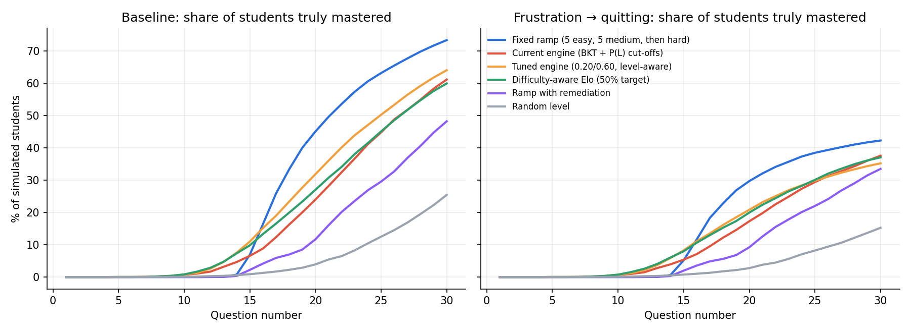
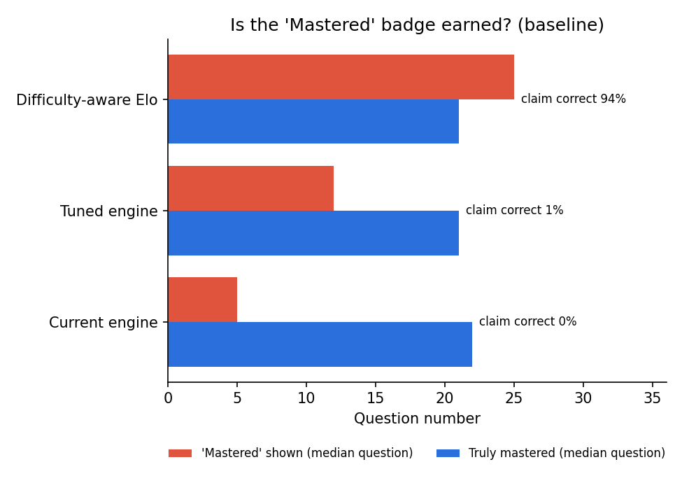
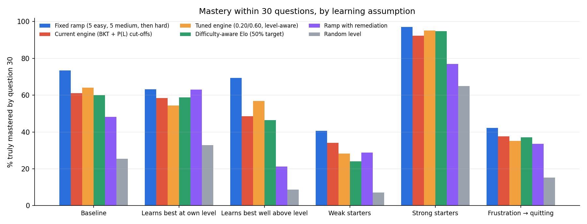
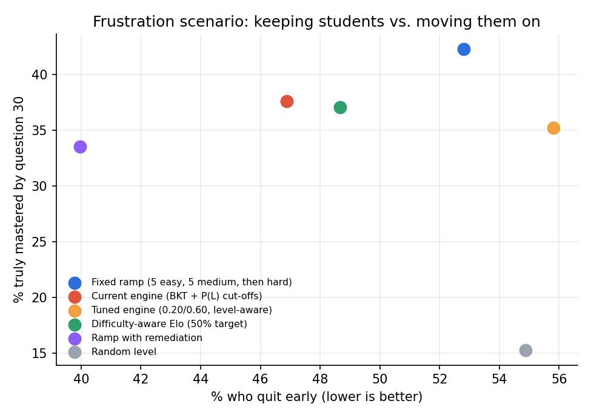

# Neuro-Learn — Evaluation: fixed vs adaptive difficulty

> Phase 5 of [FUTURE_WORKFLOW.md](../FUTURE_WORKFLOW.md). Run on 2026-11-10.
> Code: `backend-java/src/main/java/com/neurolearn/evaluation/` · Data and charts: [`docs/evaluation/`](evaluation/)
> **This is a simulation study.** Real students were not involved; every result depends on the
> assumptions in §3, which are varied in §4.3. Real-data validation needs a classroom pilot (§7).

---

## 1. Summary

1. **The app's current adaptive engine does not beat a simple fixed progression** at getting simulated
   students to mastery. Baseline: **61.2%** reach mastery within 30 questions with the engine vs
   **73.4%** with a fixed ramp (5 easy → 5 medium → hard). Both are far better than random levels (25.4%).
2. **The "Mastered" badge is almost never earned.** The engine says "mastered" (P(L) ≥ 0.85) after a
   median of **5 questions**, while true mastery takes a median of **22**. When it says "mastered", the
   student truly is **0.0%** of the time. A difficulty-aware ability estimate (Elo) gets this right
   **94.3%** of the time.
3. **When frustrated students can quit, adaptivity keeps more of them going** (current engine: 46.9% quit
   vs fixed ramp: 52.8%), and the learning gap narrows (37.6% vs 42.3% mastered) — but the fixed ramp
   still reaches the most mastery. Tuning the engine purely for speed made quitting *worse* (55.8%).
4. **The BKT fitter works** (recovers known parameters within about ±0.02), but the app's logged data
   (60 answers, 8 students) is **far too small** to fit real parameters.

**What to change now:** base "Mastered" on difficulty-aware evidence (§6.1). **What to measure next:**
real-student difficulty and learning curves in a pilot before re-tuning difficulty selection (§7).

---

## 2. What was compared

All policies choose the level (1 easy, 2 medium, 3 hard) of the next question for one student and topic.

| Policy | How it picks the next level |
|---|---|
| **Fixed ramp** | 5 questions at level 1, 5 at level 2, then level 3. Ignores answers. |
| **Current engine** | Neuro-Learn's real `AdaptiveEngineService`, unchanged: BKT update after every answer; first question level 1; then P(L) < 0.40 → 1, < 0.75 → 2, else 3. |
| **Tuned engine** | Same BKT, cut-offs **0.20 / 0.60** and *level-aware evidence* (a correct easy answer counts as more guessable: P(G) 0.60 / 0.40 / 0.25 for levels 1/2/3). Chosen by a grid search on a separate training population (§3.4). Evaluation only — not in the app. |
| **Difficulty-aware Elo** | Running ability estimate updated by how surprising each answer was for that item's difficulty; picks the level with predicted success closest to **50%** (50/60/70% tried on the training population). Mastery claimed when predicted level-3 accuracy ≥ 70%. Evaluation only. *Advantage:* it is given the true item difficulties, as if calibrated with IRT. |
| **Ramp with remediation** | Fixed ramp, but drop back a level after 2 wrong answers in a row. A teacher's rule of thumb; no tuned parameters. |
| **Random** | Uniformly random level. A floor. |

---

## 3. How the simulation works

### 3.1 Simulated student (ground truth the engine cannot see)

| Part | Model | Value |
|---|---|---|
| Ability | θ (logits); population θ₀ ~ N(μ, 0.8) | μ = −1.0 (baseline) |
| Item difficulty | b for levels 1/2/3 | −1.0 / 0.5 / 2.0 |
| Answering | P(correct) = c + (1 − c − s)·σ(a(θ − b)) | guess c = 0.25 (4 options), slip s = 0.05, a = 1.2 |
| Learning | each attempt adds η·exp(−((b − θ) − δ)² / 2w²) to θ | η ~ U(0.10, 0.30) per student; peak at δ = 0.5 logits above the student; w = 1.0 |
| True mastery | expected accuracy on level-3 items ≥ 70% | |
| Quitting (one scenario) | after k wrong in a row, quit with probability 0.04·k | off in all other scenarios |

Learning peaking a little *above* the student is the "zone of proximal development" idea. It is the key
assumption, so §4.3 varies it.

### 3.2 Fair comparison

Every student is replayed under every policy with the **same** starting ability, learning rate and random
draws for answers and quitting (common random numbers). Differences come from the policy, not luck.

### 3.3 Metrics

- **Mastered by question 20 / 30**: share of students whose *true* ability reached mastery.
- **Median questions to mastery**: among students who got there.
- **Too hard**: share of questions the student had < 50% chance of answering correctly.
- **Quit**: share of students who stopped early (frustration scenario only).
- **Claim correct**: when a policy first says "mastered", how often the student truly was.

(A "productive 50–85% success" share is also in `summary.csv`, but it rewarded policies that kept students
on items they mostly got right, which in this model teach little — so it is not used for conclusions.)

### 3.4 Train / test split

Cut-offs and the Elo target were chosen on a **training population** (5,000 students, seed 1,
[`tuning.csv`](evaluation/tuning.csv)); every result below is on a different **test population**
(5,000 students, seed 42).
Horizon: 30 questions per student, one topic.

---

## 4. Results

### 4.1 Baseline (5,000 students, 30 questions)

| Policy | Mastered by Q20 | Mastered by Q30 | Median Q to mastery | Too hard | "Mastered" claimed at (median Q) | Claim correct |
|---|---|---|---|---|---|---|
| Fixed ramp | **45.1%** | **73.4%** | **19** | 38.3% | — | — |
| Current engine | 24.0% | 61.2% | 22 | 37.9% | 5 | 0.0% |
| Tuned engine | 31.9% | 64.1% | 21 | 44.8% | 12 | 1.4% |
| Difficulty-aware Elo | 27.0% | 60.0% | 21 | 31.2% | 25 | **94.3%** |
| Ramp with remediation | 11.7% | 48.2% | 24 | **17.8%** | — | — |
| Random | 3.9% | 25.4% | 26 | 41.5% | — | — |



### 4.2 Is the "Mastered" badge earned?



BKT treats a topic as one skill and does not know item difficulty, so three or four correct *easy*
answers push P(L) past 0.85. In the app this is the "MASTERED 🏆" badge on the roadmap and the teacher's
"Mastered" status. Making easy wins count less (tuned engine) delays the claim (question 12) but it is still
almost always early. Only the difficulty-aware estimate claims mastery when it is true.

### 4.3 Sensitivity: does the conclusion depend on the assumptions?

Mastered by question 30:

| Scenario | Fixed ramp | Current engine | Tuned engine | Elo | Ramp + remediation | Random |
|---|---|---|---|---|---|---|
| Baseline | **73.4%** | 61.2% | 64.1% | 60.0% | 48.2% | 25.4% |
| Learns best at own level (δ = 0) | **63.1%** | 58.5% | 54.4% | 58.8% | **63.1%** | 32.9% |
| Learns best well above level (δ = 1) | **69.4%** | 48.6% | 56.9% | 46.5% | 21.2% | 8.7% |
| Weak starters (μ = −2) | **40.7%** | 34.1% | 28.4% | 24.1% | 28.8% | 7.1% |
| Strong starters (μ = +0.5) | **97.0%** | 92.2% | 95.1% | 94.8% | 76.9% | 64.9% |
| Frustration → quitting | **42.3%** | 37.6% | 35.2% | 37.1% | 33.5% | 15.3% |



The fixed ramp leads in every scenario. Two things explain it within this model: learning only happens on
attempts, so pushing to harder items sooner pays off; and simulated students never get bored or
discouraged unless quitting is switched on. Strong starters are where adaptivity helps early: the
current engine has 19% mastered by question 10 vs about 1% for the ramp (see `summary.csv`).

### 4.4 Frustration: keeping students vs moving them on

| Policy | Quit early | Mastered by Q30 |
|---|---|---|
| Fixed ramp | 52.8% | **42.3%** |
| Current engine | 46.9% | 37.6% |
| Tuned engine (selected for speed) | 55.8% | 35.2% |
| Difficulty-aware Elo | 48.7% | 37.1% |
| Ramp with remediation | **40.0%** | 33.5% |
| Random | 54.9% | 15.3% |



The current engine, Elo and remediation reduce quitting by 4–13 points, but in this model the students kept
are mostly ones who would not have reached mastery anyway, so total mastery stays highest with the ramp.
The **tuned engine shows the risk of optimising one number**: cut-offs chosen for speed in the no-quit
world pushed students harder and gave the *most* quitting here. (Exploratory, not part of the train/test
protocol: the more conservative 0.30/0.75 level-aware variant had 42.4% quit and 41.1% mastered.)

---

## 5. Fitting BKT to data

### 5.1 The fitter works (parameter recovery)

Data simulated from known BKT parameters (500 students × 12 answers each) and fitted back:

| Case | True P(L₀) / P(T) / P(G) / P(S) | Fitted |
|---|---|---|
| 1 | 0.20 / 0.15 / 0.20 / 0.08 | 0.22 / 0.14 / 0.21 / 0.07 |
| 2 | 0.10 / 0.08 / 0.25 / 0.10 | 0.10 / 0.08 / 0.25 / 0.10 |
| 3 | 0.40 / 0.25 / 0.15 / 0.05 | 0.40 / 0.27 / 0.15 / 0.05 |

Method: maximum likelihood (grid search, then coordinate refinement), with P(G) ≤ 0.40 and P(S) ≤ 0.30
to avoid the usual degenerate BKT fits.

### 5.2 The app's logged data is too small

[`logged_attempts_anonymised.csv`](evaluation/logged_attempts_anonymised.csv) (student ids only, no names):
**60 answers from 8 students across 5 topics**; only `intro` has more than 2 students (8 students, 46
answers). Every topic is flagged "too little data" (threshold: ≥ 30 students and ≥ 300 answers per topic).
The fitted values in [`bkt_fit_logged.csv`](evaluation/bkt_fit_logged.csv) hit the parameter bounds and
must **not** be used. The engine keeps its default parameters.

---

## 6. Recommendations

### 6.1 Change now (low risk)
- **Earn "Mastered" with hard questions.** Simplest version: only show "Mastered" when P(L) ≥ 0.85 **and**
  the student has answered at least 2 level-3 questions correctly in that topic. Better version: a
  difficulty-aware estimate (Elo/IRT, §2). This fixes the most misleading output in the app — it
  affects the student roadmap, the teacher roster and parent report cards.
- **Report this honestly** in the project write-up: the adaptive engine is explainable and keeps students
  in a reasonable band, but its advantage over a well-designed fixed sequence is not demonstrated.

### 6.2 Needs real data first
- **Difficulty selection.** Don't re-tune cut-offs on simulated data alone — the tuning result flipped
  between the no-quit and frustration scenarios. Collect a pilot first (§7), then tune on real logs.
- **IRT calibration** of item difficulty (needs about 500 respondents for a stable 2PL) — this is what
  the Elo policy assumed it had.
- **Per-topic BKT parameters** with the fitter here, once each topic has ≥ 30 students.

---

## 7. Threats to validity

- **Simulated students.** The learning curve, item difficulties and mastery threshold are assumptions;
  real learning includes forgetting, motivation, boredom and transfer between topics, none of which are
  modelled except crude quitting.
- **One topic, 30 questions.** Real use spans sessions and days.
- **The Elo policy had an advantage** (true item difficulties).
- **Self-referential tuning.** Tuning on a simulator finds the simulator's optimum; the train/test split
  only protects against noise, not against wrong assumptions.

A credible next step is a **pilot**: one class, a few weeks, half the students on the fixed ramp and half
on the adaptive engine (the app already logs the selected option, hints and every adaptive decision since
V9), with a short pre/post test.

---

## 8. Reproduce

From `backend-java/` (JDK 17+; no database needed):

```bash
./mvnw -q compile
java -cp target/classes com.neurolearn.evaluation.EvaluationRunner tune ../docs/evaluation/tuning.csv 5000 1
java -cp target/classes com.neurolearn.evaluation.EvaluationRunner simulate ../docs/evaluation 5000 30 42
java -cp target/classes com.neurolearn.evaluation.EvaluationRunner recovery ../docs/evaluation/bkt_recovery.csv
java -cp target/classes com.neurolearn.evaluation.EvaluationRunner fit ../docs/evaluation/logged_attempts_anonymised.csv ../docs/evaluation/bkt_fit_logged.csv
cd ../docs/evaluation && python make_charts.py
```

Unit tests (`EvaluationModelTest`, `EvaluationRunnerTest`) check the model, policies, simulator
determinism, fitter recovery and the CSV outputs, including a regression guard on the headline ordering.
