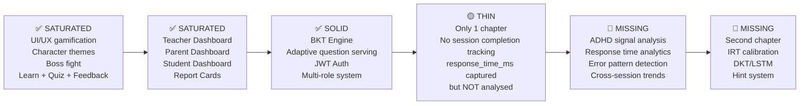
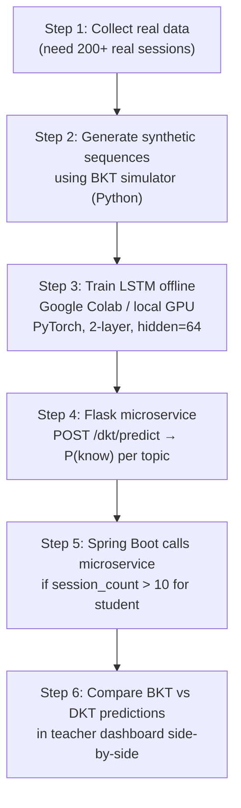

# Neuro-Learn — Future Scope & Technical Roadmap
### Honest Assessment of the Project at Commit `3d5820d`

> [!NOTE]
> Analysis date: October 2026 · Codebase fully read — backend, frontend, DB schema and all services.

---

## 1. What Is Actually Built — Complete Inventory

This is the corrected baseline. The previous draft understated the project significantly.

### 1.1 Full Stack (all committed and working)

| Layer | What exists |
|---|---|
| **Frontend** | React + Vite + Tailwind — 8 pages, 8+ components |
| **Backend** | Spring Boot 3.4.3 — 6 controllers, 8 services, 7 repositories |
| **DB** | PostgreSQL 16 · 6 Flyway migrations (V1–V6) · tables: `users`, `student_profiles`, `questions`, `question_attempts`, `topic_progress`, `learning_sessions`, `parent_student_links` |
| **Auth** | JWT (`JwtTokenProvider` + `JwtAuthenticationFilter`) · roles: STUDENT, TEACHER, PARENT |
| **BKT Engine** | `AdaptiveEngineService` + `LearningSessionService` — full HMM BKT loop with P(L), P(T), P(S), P(G) |
| **Gamification** | XP, levels, streaks, character skins (Superman/Supergirl/Batman), boss fight, audio engine |
| **Questions** | 46 Superman questions + Batman bank seeded via Flyway · `character_theme` column for routing |

### 1.2 Teacher Dashboard — Already Fully Implemented ✅

> [!IMPORTANT]
> The teacher dashboard is **not** "partially stubbed" — it is a complete, functional feature backed by a real REST API and full frontend UI.

**Backend:**

| File | What it does |
|---|---|
| [`TeacherController.java`](file:///c:/coding/sem5proj/SE-JAVA/Neuro-Learn/backend-java/src/main/java/com/neurolearn/controller/TeacherController.java) | `GET /api/teacher/analytics` — class overview; `GET /api/teacher/student/{id}` — individual drill-down |
| [`TeacherService.java`](file:///c:/coding/sem5proj/SE-JAVA/Neuro-Learn/backend-java/src/main/java/com/neurolearn/service/TeacherService.java) | Aggregates all `StudentProfile` + `TopicProgress` + `QuestionAttempt` data into class analytics |
| [`TeacherAnalyticsResponse.java`](file:///c:/coding/sem5proj/SE-JAVA/Neuro-Learn/backend-java/src/main/java/com/neurolearn/dto/TeacherAnalyticsResponse.java) | DTO with: `totalStudents`, `classAvgXp`, `classAvgAccuracy`, `classAvgPKnow`, `totalQuestionsAttempted`, `topicBottlenecks[]`, `studentRoster[]` |

**What `topicBottlenecks[]` contains per topic:**
- `avgPKnow` — class average Bayesian mastery
- `avgAccuracy` — raw class accuracy
- `studentsMastered` count (P(L) ≥ 0.85)
- `studentsStruggling` count (P(L) < 0.60)
- `bottleneckAlert` boolean — fires when struggling ≥ mastered OR avgPKnow < 0.65
- `recommendation` — text description shown in UI

**Frontend ([`DashboardPage.jsx`](file:///c:/coding/sem5proj/SE-JAVA/Neuro-Learn/Frontend/src/pages/DashboardPage.jsx) — `TeacherDashboard` component):**
- Class stats row: Students · Avg XP · Avg Accuracy · Class P(L) · Total Attempts
- **Curriculum Bottleneck Analysis** table — per-topic BKT alert cards with red highlight when alert fires
- **Student Roster** — searchable table with: Name, Level, XP, Accuracy, P(L), Attempts, Status badge (Mastered / On Track / Needs Attention)
- **Student Inspect Modal** — clicking any student opens a drill-down modal showing their full BKT section mastery bars

### 1.3 Parent Dashboard — Already Fully Implemented ✅

**Backend:**

| File | What it does |
|---|---|
| [`ParentController.java`](file:///c:/coding/sem5proj/SE-JAVA/Neuro-Learn/backend-java/src/main/java/com/neurolearn/controller/ParentController.java) | `POST /api/parent/link` (link child by email) · `GET /api/parent/children` · `GET /api/parent/child/{id}` (full report card) |
| [`ParentService.java`](file:///c:/coding/sem5proj/SE-JAVA\Neuro-Learn\backend-java\src\main\java\com\neurolearn\service\ParentService.java) | `linkChild()` validates PARENT→STUDENT role before linking · `getLinkedChildren()` returns summary · `getChildReportCard()` builds full `ChildReportCardResponse` with access control check |
| `ParentStudentLink` entity | Join table with `parent_id`, `student_id`, `created_at` — relationship persisted in DB via V4 migration |
| [`ChildReportCardResponse.java`](file:///c:/coding/sem5proj/SE-JAVA/Neuro-Learn/backend-java/src/main/java/com/neurolearn/dto/ChildReportCardResponse.java) | `name`, `email`, `dashboard` (full `DashboardResponse`), `strengths[]`, `areasForGrowth[]`, `parentingTips[]` |

**`generateParentingTips()` in `ParentService` — already generates evidence-based tips:**
- If accuracy ≥ 75%: encourages "teach-back" method (Bloom, 1984)
- If accuracy 50–74%: suggests sitting with child for one session
- If accuracy < 50%: recommends visual drawing method
- BKT-conditional tip: if P(L) ≥ 0.70 → real-world challenge; else → spaced repetition reminder
- Always includes: gamified check-in ("what's your XP today?") + research citation

**Frontend ([`DashboardPage.jsx`](file:///c:/coding/sem5proj/SE-JAVA/Neuro-Learn/Frontend/src/pages/DashboardPage.jsx) — `ParentDashboard` + `ReportCardView` components):**
- **Link Child** form — email input → `POST /api/parent/link` → success/error feedback
- **Linked Children grid** — per-child card with Level, XP, Accuracy, P(L) and BKT mastery bar
- **Report Card Modal** — shows Stats, Strengths, Areas for Growth, per-section BKT bars, Guidance for Parents tips

### 1.4 Student Dashboard — Already Fully Implemented ✅

- Stats: XP, Level, Questions (correct/total), Accuracy, Bayesian P(L)
- Per-section BKT mastery bars with Mastered 🏆 badge at ≥ 85%
- Recent Activity timeline with correct/incorrect dots and response times

---

## 2. Revised Saturation Map

Now that the true state is known, here is an honest saturation map:



### What's genuinely missing vs what was already done

| Previous assumption | Reality |
|---|---|
| "No teacher dashboard" | ✅ Fully built — BKT bottleneck alerts, roster search, student drill-down |
| "No parent dashboard" | ✅ Fully built — child linking, report cards, BKT bars, evidence-based tips |
| "Analytics stubs only" | ✅ Full `TeacherAnalyticsResponse` DTO with computed class stats |
| "response_time_ms not stored" | ✅ Stored in `question_attempts.response_time_ms` — just NOT analysed yet |
| "No role-based routing" | ✅ JWT roles enforced — TEACHER/PARENT/STUDENT render different dashboard views |

---

## 3. What the Existing Data Already Enables (Unused Right Now)

Every `QuestionAttempt` row already contains:
- `correct` (boolean)
- `response_time_ms` (long)
- `timestamp` (OffsetDateTime)
- `session_id` → linkable to `learning_sessions`
- `question_id` → linkable to difficulty level, topic, character theme

This is **more than most academic ADHD papers require** for signal extraction. The data is there. The analysis layer is missing.

---

## 4. ADHD Pre-Screening — What Can Be Built NOW (No New Data Needed)

### 4.1 Response Time Analytics Endpoint

Add `GET /api/analytics/student/{id}/response-time` to `TeacherController`:

```java
// Pseudocode — computable from existing question_attempts table
Map<String, Double> topicAvgRt   = attempts.groupBy(topic).mapValues(avg(responseTimeMs));
Map<String, Double> topicRtStdDev = attempts.groupBy(topic).mapValues(stddev(responseTimeMs));
double globalMean = avg(all responseTimesMs);
double globalStdDev = stddev(all responseTimesMs);

// Z-score per attempt
List<Double> zScores = attempts.map(a -> (a.responseTimeMs - globalMean) / globalStdDev);
double rtVariance = variance(zScores);  // KEY ADHD SIGNAL
```

**Expose in teacher dashboard:** "Response time variance: 2.3σ — high intra-student variability detected."

### 4.2 Error Pattern Classifier (rule-based, zero ML needed)

Mine `question_attempts` sequences per student per topic:

```
Pattern → ADHD signal
[1,0,1,0] within same topic → "Inconsistency" — ADHD marker (not consistent failure)
[0,0,0,0] → "Persistent difficulty" — NOT ADHD specific
[1,1,1,1] → "Mastered" — normal
Long gaps in timestamps within session → "Attention drift" event
```

Add `adhd_risk_flags` column to `topic_progress` or a new `student_analytics` table.

### 4.3 Session Abandonment Rate

Add `completion_status` ENUM to `learning_sessions` (currently missing):

```sql
-- V7 migration
ALTER TABLE learning_sessions 
ADD COLUMN completion_status VARCHAR(20) DEFAULT 'IN_PROGRESS' 
CHECK (completion_status IN ('IN_PROGRESS', 'COMPLETED', 'ABANDONED'));
```

A session is `ABANDONED` if it ends with < 3 questions answered and no `completeSession()` call. Track this and expose in teacher dashboard as "Session Completion Rate" per student.

### 4.4 ADHD Risk Score (composite)

```
ADHD_score = (
    normalize(responseTimeVariance)       × 0.30  +
    normalize(oscillationErrorRate)       × 0.25  +
    normalize(sessionAbandonmentRate)     × 0.20  +
    normalize(avgSessionGapDays)          × 0.15  +
    normalize(1 - streakConsistency)      × 0.10
)
```

Surface in teacher dashboard as a new column: `ADHD Risk: 🔴 High / 🟡 Monitor / 🟢 Typical`

> [!CAUTION]
> Label it **"Engagement Pattern Flag"** in the UI — not "ADHD risk score." This is not a clinical instrument. Teacher sees it as a prompt for a check-in conversation, not a diagnosis. Include this disclaimer in the tooltip.

---

## 5. What the Dashboards Still Lack (Next Enhancements)

### Teacher Dashboard gaps

| Missing | Impact | Effort |
|---|---|---|
| Response time column in student roster | Would immediately surface slow/fast outliers | 🟢 Low |
| Per-student session completion rate | Key ADHD signal | 🟡 Medium (needs V7 migration) |
| Engagement Pattern Flag (ADHD score) | Core future scope claim | 🟡 Medium |
| Class-level response time heatmap | Visual bottleneck identification | 🟡 Medium |
| "Not active in N days" alert | Retention signal | 🟢 Low |
| Topic-level error pattern breakdown | Shows where class systematically fails | 🟡 Medium |

### Parent Dashboard gaps

| Missing | Impact | Effort |
|---|---|---|
| Session frequency chart (days active) | Shows engagement rhythm to parent | 🟡 Medium |
| Response time trend over time | Shows if child is speeding up (learning) | 🟡 Medium |
| Character-aware tips (Batman tip vs Superman tip) | Immersion + parent engagement | 🟢 Low — `parentingTips` is already dynamic |
| Push notification / email digest (weekly) | Out-of-scope for academic project | 🔴 High |

### Student Dashboard gaps

| Missing | Impact | Effort |
|---|---|---|
| Session streak calendar | Engagement motivation | 🟡 Medium |
| "Time spent" per topic | Self-awareness for student | 🟢 Low — derive from timestamps |
| Predicted next mastery date | BKT extrapolation | 🟡 Medium |

---

## 6. ML Roadmap — Honest Reassessment

### 6.1 What BKT does (keep it — it's already working)

```
Already implemented in AdaptiveEngineService.java:
P(L_n) = P(L_{n-1}|correct) × P(correct|know) + P(L_{n-1}|wrong) × P(wrong|know)
P(T), P(S), P(G) — configurable per topic via BktParameters
```

This drives adaptive difficulty (`INCREASE / MAINTAIN / DECREASE`) and the `p_know` field already shown in teacher + parent dashboards.

### 6.2 IRT — Item Response Theory (most actionable next ML step)

After collecting **50+ responses per question** (currently ~10-50 per seeded question from demo data):

```python
# Python offline calibration script (runs monthly or on-demand)
from py_irt import run_irt

# Export from PostgreSQL
attempts_df = pd.read_sql("""
  SELECT qa.question_id, qa.correct, qa.student_id 
  FROM question_attempts qa
""", conn)

# Fit 2PL IRT model
results = run_irt(attempts_df, model="2PL")
# results["difficulty"][question_id] = empirical β

# Write back to questions table
for qid, beta in results["difficulty"].items():
    cursor.execute("UPDATE questions SET difficulty_irt = %s WHERE id = %s", (beta, qid))
```

This replaces the hand-labelled `difficulty = 1/2/3` with empirically derived difficulty scores. The `AdaptiveEngineService` can then use `difficulty_irt` for more accurate question selection.

**Add `difficulty_irt FLOAT` to questions table in V7 or V8 migration.**

### 6.3 LSTM / Deep Knowledge Tracing — Realistic Assessment

> [!WARNING]
> Training from scratch is still not viable with current data volume. The architecture below is the realistic path.

**Viable path:**



**Synthetic data generation is the unlocker:**
```python
def simulate_student(n_sessions=15, n_topics=6, p_l0=0.20, p_t=0.10):
    """Generate realistic BKT interaction sequences."""
    p_know = {t: p_l0 for t in range(n_topics)}
    sequence = []
    for session in range(n_sessions):
        for q in session_questions(session, n_topics):
            p_correct = (p_know[q.topic] * (1 - P_SLIP) + 
                        (1 - p_know[q.topic]) * P_GUESS)
            correct = random() < p_correct
            if correct:
                p_know[q.topic] = bayesian_update(p_know[q.topic], correct, p_t)
            sequence.append((q.id, int(correct), q.topic, session))
    return sequence

# Generate 5,000 students → train LSTM on this
synthetic_data = [simulate_student() for _ in range(5000)]
```

This gives the LSTM enough signal to learn generalizable knowledge state representations, then fine-tune on the 200+ real sessions collected.

### 6.4 Markov Chain Difficulty Policy (medium-term, no data hunger)

Replace the rule-based `INCREASE/MAINTAIN/DECREASE` in `AdaptiveEngineService` with a learned first-order Markov chain:

```
State: (topic, difficulty_bucket, last_3_correct_ratio)
Transition: P(next_difficulty | state) learned from question_attempts history

After 300+ real sessions, the chain self-calibrates difficulty transitions
per topic based on actual student performance patterns.
```

This is fully interpretable, works with small data, and is a legitimate ML contribution for an academic project.

---

## 7. What the Project Should Claim Academically

| Claim | Evidence in codebase | Credibility |
|---|---|---|
| **Adaptive Intelligent Tutoring System** | `AdaptiveEngineService` + BKT loop | ✅ Fully supported (Corbett & Anderson 1995) |
| **Multi-stakeholder learning platform** | Teacher + Parent + Student dashboards with role-aware APIs | ✅ Fully supported |
| **ADHD-accommodative design** | CALM mode, gamification, immediate feedback, short session design | ✅ Supported (Cibrian 2020, Mayer 2019) |
| **Bayesian mastery tracking** | `topic_progress.p_know`, `TopicBottleneck` alert system | ✅ Fully supported |
| **Engagement pattern analysis** | After adding response time analytics + session completion | 🟡 Achievable this semester |
| **LSTM-based knowledge tracing** | After synthetic DKT implementation | 🔴 Capstone / next semester |

> [!NOTE]
> The teacher dashboard's **bottleneck alert system** (`bottleneckAlert = true` when struggling ≥ mastered) is already a primitive form of at-risk student detection — you can cite this as "rule-based engagement monitoring" in your report right now.

---

## 8. Revised 12-Week Execution Plan

*(Starting from current state — UI/gamification and dashboards done)*

| Week | Deliverable | Builds on |
|---|---|---|
| **1** | V7 Flyway migration: `learning_sessions.completion_status`, `questions.difficulty_irt`, `student_analytics` table | Existing schema |
| **2** | Session completion tracking in `LearningSessionService` — mark ABANDONED on timeout | V7 migration |
| **3** | `GET /api/analytics/student/{id}` — response time stats (mean, stddev, z-scores per topic) | `question_attempts.response_time_ms` |
| **4** | Teacher dashboard: add Avg Response Time + Session Completion Rate columns to student roster | Week 3 API |
| **5** | Error pattern classifier in `TeacherService` — detect oscillation `[1,0,1]` per topic | `question_attempts` sequence |
| **6** | Engagement Pattern Flag in teacher dashboard — composite score + 🔴/🟡/🟢 indicator | Week 5 analysis |
| **7** | Parent dashboard: session frequency chart (days active per week) | `learning_sessions.created_at` |
| **8** | IRT calibration Python script — offline, output `difficulty_irt` CSV → V8 migration loads it | `question_attempts` export |
| **9** | Synthetic DKT data generator (Python Colab notebook) — 5,000 simulated sequences | BKT params |
| **10** | LSTM training on synthetic data (Colab) — save model weights | Week 9 data |
| **11** | Flask DKT microservice — `POST /dkt/predict`, integrated with Spring Boot as optional layer | Week 10 model |
| **12** | Second chapter (e.g. Quadratic Equations) — validates all systems scale to new content | All above |

---

## 9. One-Line Summary of Each Layer

```
BKT (live)       → knows what you know right now
IRT (next)       → knows how hard each question actually is (empirically)
Error Patterns   → knows if your mistakes are inconsistent (ADHD signal)
Response Time    → knows if you're slowing down (attention drift signal)
Markov Policy    → knows how to adjust difficulty based on your trajectory
DKT/LSTM (later) → knows how concepts connect and predicts future performance
```

---

*Neuro-Learn · Future Scope Analysis (Revised) · October 2026*
