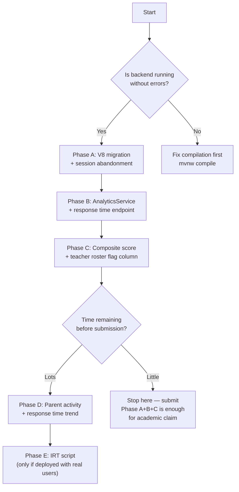

# Neuro-Learn — Detailed Next Steps Plan
### State at Commit `a0eb976` (Nov 2026)

> [!NOTE]
> All UI/gamification, dashboards (Teacher/Parent/Student), BKT engine, and Chapter 2 are **done**.
> The entire remaining scope is the **ADHD Engagement Analytics Layer**.

---

## Phase A: Database + Session Completion Tracking

### A1 — V8 Flyway Migration (`V8__add_analytics_schema.sql`)

Three schema changes in one migration:

```sql
-- 1. Session completion status
ALTER TABLE learning_sessions
  ADD COLUMN completion_status VARCHAR(20) NOT NULL DEFAULT 'IN_PROGRESS'
  CHECK (completion_status IN ('IN_PROGRESS', 'COMPLETED', 'ABANDONED'));

-- 2. IRT-calibrated difficulty (for future IRT/ML use)
ALTER TABLE questions
  ADD COLUMN difficulty_irt FLOAT;

-- 3. Engagement analytics snapshot per student
CREATE TABLE student_analytics (
    id                    BIGSERIAL PRIMARY KEY,
    student_profile_id    BIGINT NOT NULL UNIQUE REFERENCES student_profiles(id),
    avg_response_time_ms  BIGINT,
    rt_std_dev_ms         BIGINT,
    rt_variance_z         DOUBLE PRECISION,        -- normalized RT variance (ADHD signal)
    oscillation_rate      DOUBLE PRECISION,        -- [1,0,1] pattern rate (ADHD signal)
    session_completion_rt DOUBLE PRECISION,        -- % sessions completed
    engagement_flag       VARCHAR(10) DEFAULT 'TYPICAL', -- TYPICAL / MONITOR / HIGH
    last_computed_at      TIMESTAMPTZ DEFAULT NOW()
);
```

### A2 — Session Abandonment Logic in `LearningSessionService`

**Rule:** A session is ABANDONED if:
- `completeSession()` is never called AND
- fewer than 3 questions were answered in that session

**Implementation:**
- Add `completionStatus` field to `LearningSession.java` entity
- In `completeSession()`: set `COMPLETED`
- New scheduled job `@Scheduled(fixedDelay = 300000)` (every 5 min): find sessions with `status = IN_PROGRESS` older than 10 minutes with `questionsAttempted < 3` → mark `ABANDONED`
- If `questionsAttempted >= 3` but never completed → also mark `ABANDONED` after 10 min timeout

> [!WARNING]
> Need to add `@EnableScheduling` to `BackendJavaApplication.java`

---

## Phase B: Response Time Analytics Endpoint

### B1 — `AnalyticsController.java` + `AnalyticsService.java` (NEW)

```
GET /api/analytics/student/{studentId}/response-time
```

Returns per-student response time stats:

```json
{
  "globalMeanMs": 12400,
  "globalStdDevMs": 4200,
  "rtVarianceZ": 2.3,
  "perTopicStats": [
    { "topic": "quad_intro", "avgMs": 9800, "stdDevMs": 2100, "zScore": -0.61 },
    { "topic": "elimination", "avgMs": 18600, "stdDevMs": 7400, "zScore": 1.47 }
  ],
  "slowestTopic": "elimination",
  "fastestTopic": "quad_intro"
}
```

**Math:**
- `globalMean = avg(response_time_ms)` across all attempts for that student
- `globalStdDev = stddev(response_time_ms)`
- `rtVarianceZ = variance of per-attempt z-scores` — this is the KEY ADHD signal
  - High variance (> 1.5) = inconsistent attention → Engagement flag rises

### B2 — Error Pattern Classifier

```
GET /api/analytics/student/{studentId}/error-patterns
```

Mine `question_attempts` ordered by `timestamp` per student per topic:

| Pattern (last 4 attempts) | Classification |
|---|---|
| `[C, W, C, W]` or `[W, C, W, C]` | **OSCILLATION** — ADHD marker (inconsistent, not just failing) |
| `[W, W, W, W]` | **PERSISTENT_FAILURE** — not ADHD-specific, needs content support |
| `[C, C, C, C]` | **MASTERED** — normal |
| Any sequence with `avg_rt > 2σ above mean` | **ATTENTION_DRIFT** event |

Store detected patterns per topic per student in `student_analytics` or a separate `topic_engagement_flags` table.

---

## Phase C: Engagement Pattern Flag (Composite ADHD Score)

### C1 — Composite Score Formula

```
engagementScore = (
    normalize(rtVarianceZ)         × 0.30  +
    normalize(oscillationRate)     × 0.25  +
    normalize(1 - completionRate)  × 0.20  +
    normalize(avgSessionGapDays)   × 0.15  +
    normalize(1 - streakConsistency) × 0.10
)
```

Thresholds:
- `< 0.40` → `TYPICAL` 🟢
- `0.40–0.69` → `MONITOR` 🟡
- `>= 0.70` → `HIGH` 🔴

Store in `student_analytics.engagement_flag` — recomputed on each session complete.

### C2 — Expose in Teacher Dashboard

**`TeacherAnalyticsResponse.StudentRosterItem`** — add fields:
- `avgResponseTimeMs` (long)
- `sessionCompletionRate` (double, 0–1)
- `engagementFlag` (String: `TYPICAL` / `MONITOR` / `HIGH`)

**Frontend (`DashboardPage.jsx` — TeacherDashboard):**
- New column in student roster table: **Engagement** with 🟢/🟡/🔴 dot
- Clicking the dot shows tooltip: *"Engagement pattern suggests monitoring. Based on response time variability and session completion. Not a clinical assessment."*
- Filter toggle: "Show flagged students only"

---

## Phase D: Parent Dashboard Enhancements

### D1 — Session Frequency Data

```
GET /api/parent/child/{studentId}/activity
```

Returns: `{ "weeklyActivity": [3, 5, 2, 4, 1, 6, 3] }` — sessions per day for last 7 days.

Derive from `learning_sessions.start_time` (already stored).

### D2 — Response Time Trend for Parent View

Add to `ChildReportCardResponse`:
- `avgResponseTrend`: last-4-session rolling average response time — "Your child is answering 20% faster than last week" or "Response time has increased — may need a break"

---

## Phase E: IRT Calibration (Offline Python Script)

### E1 — Export Script

```python
# scripts/irt_calibrate.py
import psycopg2, pandas as pd
from py_irt import run_irt

conn = psycopg2.connect("postgresql://localhost:5432/neurolearn")
df = pd.read_sql("SELECT question_id, correct::int, student_id FROM question_attempts", conn)
results = run_irt(df, model="2PL")

# Output CSV for manual import or V9 migration
pd.DataFrame(results["difficulty"].items(), columns=["question_id", "difficulty_irt"]).to_csv("irt_calibrated.csv", index=False)
```

### E2 — V9 Migration loads the calibrated values

```sql
-- V9__load_irt_calibration.sql
-- Run AFTER irt_calibrate.py has generated the CSV and been reviewed
UPDATE questions SET difficulty_irt = ... WHERE id = ...;
```

> [!NOTE]
> This is only worth running after 200+ real student interactions. With demo seed data, IRT will just reflect the seeded difficulty. Park this until deployment and real usage.

---

## Decision Tree — What to Do First



---

## File Checklist

### New Files to Create
- [ ] `V8__add_analytics_schema.sql`
- [ ] `student_analytics` entity + repository
- [ ] `AnalyticsService.java`
- [ ] `AnalyticsController.java` (`GET /api/analytics/**`)
- [ ] `StudentAnalyticsResponse.java` DTO
- [ ] `scripts/irt_calibrate.py` (Python, offline)

### Files to Modify
- [ ] `LearningSession.java` — add `completionStatus` field
- [ ] `LearningSessionService.java` — set COMPLETED on `completeSession()`, ABANDONED on scheduler
- [ ] `BackendJavaApplication.java` — add `@EnableScheduling`
- [ ] `TeacherAnalyticsResponse.java` — add `avgResponseTimeMs`, `sessionCompletionRate`, `engagementFlag` to `StudentRosterItem`
- [ ] `TeacherService.java` — read from `student_analytics` table for new fields
- [ ] `DashboardPage.jsx` — teacher roster new columns + engagement dot + filter toggle

---

## Minimum Viable "ADHD Pre-Screening" Academic Claim

To justify the ADHD pre-screening framing in your report, you need **at least**:

1. ✅ BKT mastery tracking (done)
2. ✅ Multi-role dashboards (done)
3. 🔲 Response time variance analytics (Phase B)
4. 🔲 Oscillation error pattern detection (Phase B)
5. 🔲 Engagement Pattern Flag with proper disclaimer in UI (Phase C)

Once 3–5 are done, you can legitimately claim:
> *"Neuro-Learn implements a rule-based engagement pattern analysis system that detects intra-student response time variability and oscillatory error patterns — behavioral indicators correlated with attentional inconsistency in the literature (Cibrian et al., 2020; Epstein et al., 2011)."*

---

*Last updated: November 2026 · Neuro-Learn Phase B planning*
